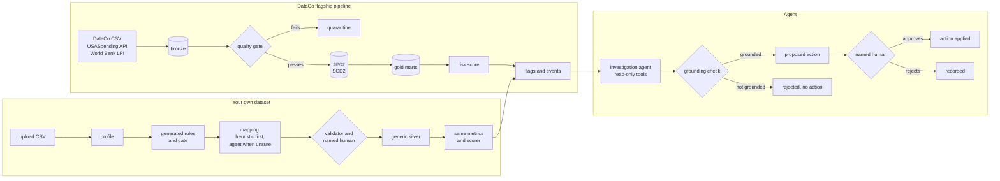

# Provenance

[](https://github.com/Ajanya-mkl/Provenance/actions/workflows/ci.yml)

Provenance is a local supply-chain risk platform.
It ingests shipment data into a medallion warehouse, stops bad batches at a quality gate, and models supplier history as SCD Type 2.
A rule-based engine scores each supplier every quarter and raises a flag when a risk tier rises and holds.
An LLM agent investigates each flag using read-only tools; every number in its report is checked against those tools, and whatever it proposes waits for a named human.
You can also upload your own shipment CSV: it is profiled, gated, mapped onto a standard contract, approved and scored by the same engine.

**The problem.** Supplier risk signals are usually a black-box number or a dashboard nobody investigates. A score that cannot explain itself is not trusted; an LLM that writes freely cannot be trusted either.

**What is agentic about it.** Two agents, both bounded by deterministic code:

- The **investigation agent** chooses which read-only tools to call, recalls past cases, writes a report and proposes an action. A grounding check rejects any report with a number no tool returned, and an approval guardrail in code stops anything taking effect without a named person.
- The **mapping agent** works out how an unfamiliar CSV fits the contract when the heuristic mapper is unsure. A validator checks its answer, a failure falls back to the heuristic, and a person approves the result.

The rule-based score is the source of truth. The agents explain and propose; they never override it.

## Architecture at a glance



Details are in [docs/architecture.md](docs/architecture.md).

## Key results

| Result | Number | Source |
|---|---|---|
| Tests | 297 unit tests pass, 5 integration tests deselected by default; 16 web tests | `pytest -q`, `npm test`; see [docs/testing.md](docs/testing.md) |
| Generic path equals the flagship | DataCo through the contract: 211 of 211 scores match, largest difference 2.4e-15; 0 tier or confidence mismatches; the same 20 flags | [tests/integration/test_dataco_equivalence.py](tests/integration/test_dataco_equivalence.py) (`pytest -m integration -s`) |
| Flag stability | 43 flags → 20 after trailing country risk and hysteresis; at most 6 in one quarter | [docs/data_profile.md](docs/data_profile.md#historical-risk-scoring-and-calibration) |
| SCD2 stability | 119 versions → 56 across 50 suppliers | [docs/data_profile.md](docs/data_profile.md#phase-4-band-thresholds) |
| Investigation agent, 18 cases | Top factor 16/16; grounded 17/18 (94.4%); 0 guardrail violations; average 2.5 steps, 4,244 tokens, 9.2 s | [docs/agent_evaluation.md](docs/agent_evaluation.md) |
| Mapping, 11 cases, every field right | Heuristic only 9/11; agent only 10/11; heuristic-first 10/11 with 3 agent calls instead of 11 (19,368 tokens against 66,988) | [docs/mapping_evaluation.md](docs/mapping_evaluation.md) |
| Reproducible from scratch | A fresh clone with an empty warehouse rebuilt the same 211 scores (61 low, 130 medium, 20 high), 20 flags and 56 SCD2 versions | [CHANGELOG.md](CHANGELOG.md) |
| Data | 180,519 DataCo order items; 211 eligible supplier-quarters across 45 categories (61 low, 130 medium, 20 high) | [docs/data_profile.md](docs/data_profile.md) |

These evaluation sets are small, and the DataCo data is likely synthetic. Read [docs/limitations.md](docs/limitations.md) before quoting them.

## Quick start (Windows cmd)

You need Python 3.12 (`py -3.12`) and Node.js LTS. No Docker, no server.

### Install and check

```bat
git clone https://github.com/Ajanya-mkl/Provenance.git
cd Provenance
py -3.12 -m venv .venv
.venv\Scripts\activate
python -m pip install --upgrade pip
pip install -r requirements-dev.txt
pip install -e .
copy .env.example .env
pytest -q
ruff check .
```

Edit `.env` and set `LLM_API_KEY` to a [Groq](https://console.groq.com) key. Only the agents need it; the tests never read it.

### Run the pipeline

Download `DataCoSupplyChainDataset.csv` ([source](#data-sources)) into `data\raw\`. Run from the repository root with the virtual environment active:

```bat
set DAGSTER_HOME=%CD%\.dagster
python -m provenance.run_pipeline
```

This does bronze ingestion, the three quality gates, silver, gold and scoring, and prints each step. It takes a few minutes and calls the USASpending and World Bank APIs.

**The very first run stops at `silver_dbt_assets: failed`, and that is expected.** The silver step runs tests on the gold tables, which do not exist yet ([why](docs/limitations.md#running-it)). Bronze and the gates have succeeded, so build everything once with dbt, then run the pipeline again:

```bat
dbt build --project-dir src\provenance\transform --profiles-dir src\provenance\transform
python -m provenance.run_pipeline
```

It should end with `Pipeline SUCCEEDED`, and later runs need only the one command.

**Offline mode.** The first successful online run caches `data\raw\usaspending_sample.json`. After that, this skips the USASpending API:

```bat
set PROVENANCE_USASPENDING_OFFLINE=true
python -m provenance.run_pipeline
```

### Dagster

```bat
set DAGSTER_HOME=%CD%\.dagster
dagster dev -m provenance.dags.definitions
```

Open http://localhost:3000. Stop it before using the CLIs or the API for writes: DuckDB allows one writer.

### API and console

In one window, from the repository root:

```bat
.venv\Scripts\activate
python -m provenance.api
```

In a second window:

```bat
cd web
npm ci
npm run dev
```

Open http://localhost:5173. There is no login, and the API serves localhost only: never expose it to a network.

**Mock mode** needs no API, warehouse or key:

```bat
cd web
npm ci
npm run dev:mock
```

### Agent and approvals

```bat
python -m provenance.agent.run --next
python -m provenance.agent.run --event-id "<event id>"
python -m provenance.agent.approve --list
python -m provenance.agent.approve --approve <action id> --by "Your Name"
python -m provenance.agent.approve --reject <action id> --by "Your Name" --reason "why"
python -m provenance.agent.approve --audit 20
```

### Onboard, map and score your own CSV

```bat
python -m provenance.datasets.onboard path\to\file.csv --name "My data"
python -m provenance.datasets.onboard --list
python -m provenance.datasets.map <dataset id>
python -m provenance.datasets.map --edit <mapping id> --set country=null --by "Your Name"
python -m provenance.datasets.map --approve <mapping id> --by "Your Name"
python -m provenance.datasets.score <dataset id>
```

### Evaluations

Both reuse cached model answers unless you pass `--fresh`, and neither writes to your warehouse.

```bat
python -m provenance.agent.eval.eval_runner
python -m provenance.datasets.eval.run
```

### Tests

```bat
pytest -q
pytest -m integration -s
ruff check .
cd web
npm run lint
npm test
npm run build
```

`pytest -q` needs no CSV, warehouse or network. `pytest -m integration` runs the DataCo equivalence test, takes about 5 minutes, works on a copy of your warehouse, and skips cleanly without the CSV and warehouse.

### A read-only tour of the warehouse

```bat
python scripts\demo_queries.py
```

## Documentation

| Document | What it covers |
|---|---|
| [docs/architecture.md](docs/architecture.md) | The system as it is, by component, and the design history |
| [docs/agent_design.md](docs/agent_design.md) | Both agents: tools, grounding, guardrail, audit, privacy, evaluation |
| [docs/data_dictionary.md](docs/data_dictionary.md) | Every schema, table and column |
| [docs/user_guide.md](docs/user_guide.md) | Using the console |
| [docs/limitations.md](docs/limitations.md) | Honest limitations and future work |
| [docs/testing.md](docs/testing.md) | Test strategy, what each file covers, CI |
| [docs/demo_script.md](docs/demo_script.md) | 3-minute and 10-minute demos, with a fallback plan |
| [docs/data_profile.md](docs/data_profile.md) | The DataCo profile and how thresholds were calibrated |
| [docs/agent_evaluation.md](docs/agent_evaluation.md), [docs/mapping_evaluation.md](docs/mapping_evaluation.md) | Generated evaluation reports |
| [CHANGELOG.md](CHANGELOG.md) | One entry per phase |
| [project.md](project.md) | The original build playbook (historical) |

## Project layout

```
config/                 Non-secret settings (schedule, offline mode)
.dagster/dagster.yaml   Single-writer run queue
data/                   Warehouse, Parquet, quarantine (git-ignored except placeholders)
docs/                   Documentation
scripts/                demo_queries.py, a read-only tour
src/provenance/
  ingestion/            Source loaders, schemas, pre-checks
  data_quality/         The quality gate and its Great Expectations suites
  transform/            dbt project: staging, silver (SCD2), gold, seeds, tests
  risk_engine/          rules.yaml and the scorer
  dags/                 Dagster assets, jobs, schedule, sensor, restore point
  agent/                Investigation agent: LLM client, loop, tools, grounding, approval, audit
  datasets/             Onboarding, mapping, generic silver and metrics, scoring runs
  api/                  FastAPI for the console
tests/                  Unit and integration tests, fixtures
web/                    React console, with a mock mode
```

## Tech stack

Python 3.12 · DuckDB · Dagster · dbt (dbt-duckdb) · Great Expectations · pandas · FastAPI · Groq (`openai/gpt-oss-120b`) · React 19, TypeScript, Vite, Tailwind, Recharts · pytest, ruff, vitest, ESLint · GitHub Actions.

## Data sources

| Source | Used for | Attribution |
|---|---|---|
| DataCo Smart Supply Chain | Shipments, the flagship | Constante, Silva, Pereira (2019), [Mendeley Data](https://data.mendeley.com/datasets/8gx2fvg2k6/5), doi:10.17632/8gx2fvg2k6.5, CC BY 4.0. Download it yourself; it is not in this repository. |
| World Bank Logistics Performance Index | Destination country risk | Indicator [`LP.LPI.OVRL.XQ`](https://data.worldbank.org/indicator/LP.LPI.OVRL.XQ), World Development Indicators. Licence: to verify. |
| USASpending.gov | Contract awards; ingested and gated, but not used in scoring | [USASpending API](https://api.usaspending.gov). Licence: to verify. |

## Limitations

The main ones: DataCo is likely synthetic, a "supplier" is really a product category, scores of a dataset are comparable only within it, the evaluation sets are small, and the console has no login. The full list is in [docs/limitations.md](docs/limitations.md).

## Licence

MIT, see [LICENSE](LICENSE).
