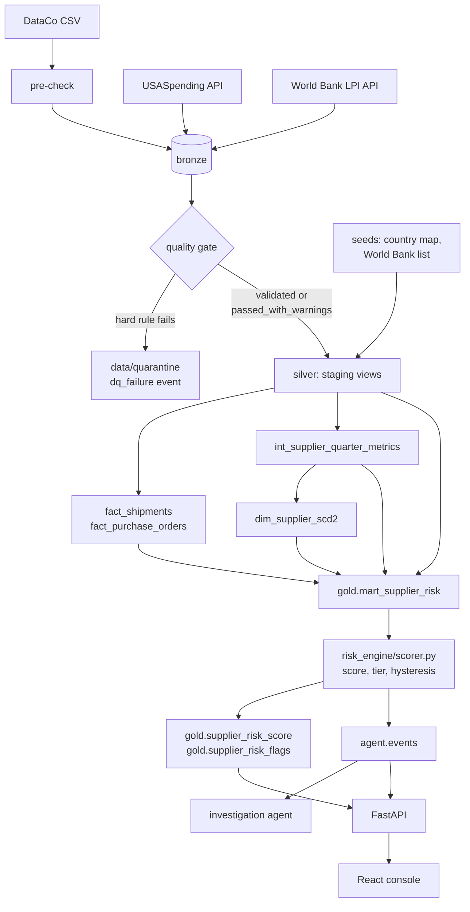
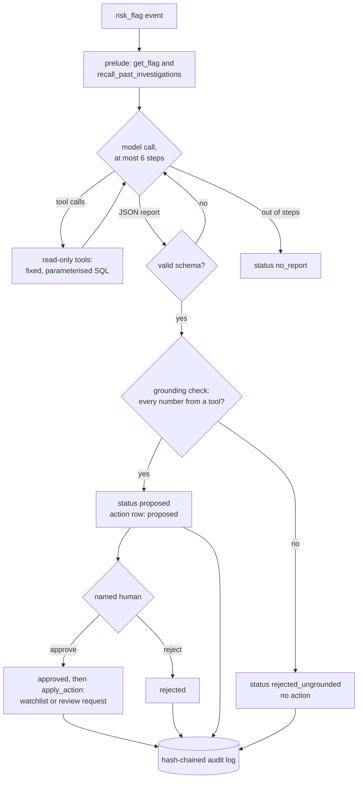
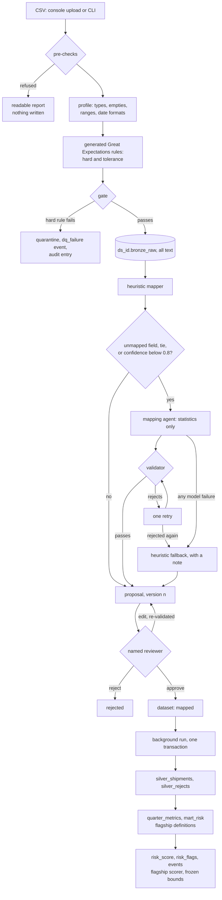

# Architecture

Provenance runs on one Windows machine with no containers or servers beyond two local processes: a warehouse file (DuckDB), Parquet folders, Dagster for orchestration, dbt for SQL models, a FastAPI service and a React console. It is organised as two paths into one scoring engine: the **DataCo flagship pipeline** and **dataset onboarding** for any CSV.

- [Data flow](#data-flow)
- [Storage and layers](#storage-and-layers)
- [Ingestion](#ingestion)
- [Quality gate](#quality-gate)
- [Silver](#silver)
- [Gold](#gold)
- [Risk engine](#risk-engine)
- [Orchestration](#orchestration)
- [Concurrency: one writer](#concurrency-one-writer)
- [Investigation agent](#investigation-agent)
- [Dataset onboarding](#dataset-onboarding)
- [API](#api)
- [Console](#console)
- [Configuration](#configuration)
- [Design decisions and history](#design-decisions-and-history)

## Data flow



USASpending is ingested, gated and modelled in staging, but nothing downstream reads it: its vendors do not join to DataCo (see [data_profile.md](data_profile.md)).

## Storage and layers

| Schema | Holds | Written by |
|---|---|---|
| `bronze` | Raw data plus lineage; gate verdicts in `dq_results` | Loaders, gate |
| `silver` | Staging views, facts, `dim_supplier_scd2`, seeds | dbt |
| `gold` | Two marts (dbt); scores and flags (scorer) | dbt, scorer |
| `agent` | Events, investigations, actions and their effects, audit log | Scorer and gate (events), `agent/store.py` |
| `meta` | Dataset registry, profiles, mappings, frozen rules, runs | `datasets/registry.py`, `datasets/mapping_store.py` |
| `ds_<id>` | One onboarded dataset | `datasets/` |

Every table and column is in [data_dictionary.md](data_dictionary.md). Parquet batches live under `data/bronze/<source>/batch_id=<hash>/`, and failed batches under `data/quarantine/`. `data/` is git-ignored.

## Ingestion

`src/provenance/ingestion/`. Each source writes an idempotent Parquet batch whose id is a content hash, then refreshes its bronze table. An unchanged source rewrites the same batch.

- **DataCo** reads the CSV with Latin-1. `precheck.py` runs first and fails with a readable list of problems, before anything is written: the exact ordered columns (read from the gate's own suite), the strict `%m/%d/%Y %H:%M` date format staging parses, blanks or non-integers in the integer columns, and `Order Country` names missing from the seed.
- **USASpending** requests the last complete calendar month and pages through it, so overlapping batches accumulate; staging keeps one row per `generated_internal_id` from the most recently loaded approved batch. Offline mode (`ingestion.usaspending_offline`, or `PROVENANCE_USASPENDING_OFFLINE`) loads the cached sample `data/raw/usaspending_sample.json` instead: the sample's hash is the batch id, so every offline run rewrites one identical batch. A missing sample fails the run rather than calling the API.
- **World Bank** loads every page of `LP.LPI.OVRL.XQ`.

Only the two API assets have a `RetryPolicy` (3 retries, exponential backoff from 1 s). The last retry may fall back to a cache (the USASpending sample, or the latest World Bank batch), and the materialization then records `cache_fallback_used`, `cache_fallback_source` and `cache_fallback_reason`. With no cache, the run fails visibly.

## Quality gate

`src/provenance/data_quality/gate.py` runs Great Expectations suites built from `expectations/bronze_suite.json` (50 rules for DataCo, 12 + 3 for USASpending, 5 + 3 for World Bank).

- Verdicts go to `bronze.dq_results`: `validated`, `passed_with_warnings` or `quarantined`. Staging reads only the first two, so a quarantined batch never reaches silver.
- A failing batch is **moved** (never copied) from `data/bronze` to `data/quarantine` with its `validation_result.json`, and a `dq_failure` event is written.
- Each batch is gated once: only batches with no `dq_results` row are checked, so a bad batch does not block later runs. The loader refuses to put a once-quarantined batch back. `rebuild_bronze_table` reads approved batches plus those still waiting for their first check.
- **Cross-batch duplicates:** a new DataCo batch is compared with approved batches by `Order Item Id` over every source column. Identical rows are dropped with a `cross_batch_duplicates` warning; the same id with any different value quarantines the whole batch.

The gate asset raises `dagster.Failure` on quarantine, so Dagster skips everything downstream.

## Silver

The dbt project is in `src/provenance/transform/` (`profiles.yml` is committed and has no secrets; it reads `PROVENANCE_DUCKDB_PATH`).

```
bronze.* ──► stg_dataco_order_items ──► fact_shipments, fact_purchase_orders
         │                          └─► int_supplier_quarter_metrics ──► dim_supplier_scd2
         ├─► stg_usaspending_awards   (date_valid flag; not linked to suppliers)
         └─► stg_worldbank_lpi        (economies only; aggregates removed via seed)
seeds: country_iso3_map (DataCo Spanish names → ISO3), wb_country_reference (World Bank list)
```

Personal data (customer email, password, names, street, zipcode) is never selected out of bronze, and a singular test enforces it.

**Supplier proxy.** `supplier_key` is `cat_` plus the slugged category name. DataCo has no supplier identifier, so a category stands in for one.

**Metrics.** `int_supplier_quarter_metrics` gives one row per supplier-quarter. Late rate and delay exclude cancelled shipments, which still count toward `shipment_count`. A supplier-quarter under 50 shipments is `low_volume`. A quarter is `partial` when the data starts after it begins, ends before it finishes, or under 90% of its days have an order.

**SCD2.** `dim_supplier_scd2` is rebuilt deterministically on every run from the quarterly series by a recursive query:

1. A full-volume, complete quarter rates `delivery_band` from the late rate (`low` < 0.50 ≤ `medium` < 0.65 ≤ `high`). `volume_band` is kept as context only.
2. A new delivery band must persist for 2 eligible quarters before it opens a version. Low-volume and partial quarters neither confirm nor reset a pending change.
3. `effective_from` is the first confirming quarter; `effective_to` is the next version's start (exclusive), null when current.

The same inputs and vars always give the same history. Singular dbt tests enforce one current row per supplier, `effective_to` null exactly when current, no gaps or overlaps, and consecutive versions that differ. Thresholds are dbt vars in `dbt_project.yml`; [data_profile.md](data_profile.md) explains how they were chosen.

## Gold

`gold.mart_supplier_risk` has one row per eligible supplier-quarter (not low volume, not partial, late rate known). Country risk is **destination-based**, not supplier-origin: for each destination, the latest LPI at or before the quarter gives `(5 − LPI) / 4`; a destination with no LPI gets the quarter's median, and `country_coverage` reports the share of shipments with a real score. It is shipment-weighted over the last 4 eligible quarters, because the dataset's destination mix swings sharply from quarter to quarter.

`gold.mart_shipment_delay` is a shipment-level mart for ad hoc analysis.

## Risk engine

`src/provenance/risk_engine/` holds `rules.yaml` (version 1.2) and `scorer.py`.

- **Score:** each factor is normalised to its bounds and clipped, then weighted.

  | Factor | Weight | Bounds |
  |---|---|---|
  | Late rate | 0.25 | 0.50 – 0.64 |
  | Delay variability (standard deviation) | 0.35 | 1.38 – 1.65 |
  | Trailing country risk | 0.40 | 0.32 – 0.53 |

- **Tiers:** `low` < 0.38 ≤ `medium` < 0.68 ≤ `high`.
- **Confidence:** `low` under 3 eligible quarters to date or 95% country coverage, otherwise `full`.
- **Flags and hysteresis:** the replay compares each eligible quarter with that supplier's previous one. A tier rise flags at once only when the score rises by more than 0.15; otherwise the new tier must hold for 2 consecutive eligible quarters. A first-ever quarter never flags.
- **Top factor:** for a rise, only factors whose weighted contribution increased can be named, and the largest change wins. If none rose, the largest current contributor is named and marked `largest_contributor_fallback`.

**Events are append-only.** The payload hash is 10 hex characters of SHA-256 over sorted-key JSON, with floats rounded to 10 decimals for the hash only (a mart rebuild sums floats in a different order, moving scores by about 1e-16). An unchanged payload keeps its event, untouched. A changed payload resolves the old event with `superseded: payload changed; replaced by <new id>`, keeping its investigations, and creates `<old id>:p<hash>`. A flag of the current rules version that stops qualifying is resolved, in both the event and the flag row. All scorer writes are one transaction. Re-scoring unchanged data adds no flags or events.

`FlagTarget` parameterises tables, key column, event prefix and source, so the same code scores datasets. Its defaults are the flagship. Dataset events use source `dataset_risk_engine`, so neither path can supersede the other's.

## Orchestration

`src/provenance/dags/definitions.py`. `provenance_full_pipeline` selects every asset; dependencies fix the order, and the job uses the in-process executor so only one step writes at a time:

```
dataco_shipments → usaspending_contracts → worldbank_lpi        (bronze)
  → gate_dataco_shipments → gate_usaspending_contracts → gate_worldbank_lpi
  → silver_dbt_assets (seeds, staging, intermediate, silver, tests)
  → gold_dbt_assets   (gold marts and their tests)
  → supplier_risk_scoring (scores, flag replay, risk_flag events)
```

- `python -m provenance.run_pipeline` runs that job in-process and prints each step (exit 0 success, 1 failure, 2 another writer active). The first run on an empty warehouse needs one manual `dbt build` ([limitations](limitations.md#running-it)).
- Smaller jobs: `ingest_all_sources`, `bronze_quality_gates`, `gates_and_silver`. Op jobs: `onboard_dataset`, `score_dataset`.
- `provenance_full_pipeline_weekly` runs on the cron in `config/config.example.yaml`, stopped by default.
- `agent_investigation_sensor`, stopped by default, moves `open` events to `queued` and starts `agent_investigation_job`, which **only logs the cases**. The agent itself is started from the CLI or the console (see [limitations](limitations.md)).
- **Reruns are idempotent:** batch ids are content hashes, dbt rebuilds from bronze, the gate upserts by `(source, batch_id)`, and the scorer's hashing adds nothing for unchanged inputs.

**All-or-nothing silver and gold.** `dags/restore_point.py` wraps both dbt assets. Before the silver build it copies every dbt-built table in `silver` and `gold` into a `_restore_point` schema. A failure in either build, a failing test included, restores them in one transaction; gold's success drops the copies. Without it, a failing test on one branch of the dbt graph could leave new silver beside old gold. Tables with a primary key (the scorer's) are not copied. A lock error means dbt never opened the file, so the restore point is kept and the step retried.

## Concurrency: one writer

DuckDB allows one writer process, and fails at once, not after a wait, in both directions: a reader cannot open while a writer holds the file, and a writer cannot open while any reader does.

- `.dagster/dagster.yaml` limits the tag `dagster/concurrency_key=duckdb_writer` to one running run. Set `DAGSTER_HOME` to that folder's absolute path, or Dagster uses a temporary instance without the limit.
- `run_pipeline` bypasses the queue, so it checks for active writer runs and refuses to start.
- `db.connect_read_only` retries a lock conflict twice (after 0.25 s and 0.5 s). The API reads through it, and answers 409 `locked` if the file is still held.
- The agent's tools open a read-only connection per tool call and close it at once, so nothing holds the file while the model thinks.
- Gate, scorer and dataset assets turn a lock error into `RetryRequested` (3 retries, 5 s apart).
- The console keeps the last loaded data on a 409, shows "Pipeline running, showing last loaded data", and checks again every 10 s.

## Investigation agent

Described fully in [agent_design.md](agent_design.md).



Runs start from `python -m provenance.agent.run` or from the console, which starts `provenance.agent.background` as a subprocess; the API process never runs the model.

## Dataset onboarding

`src/provenance/datasets/` onboards any CSV next to the flagship without touching it. It runs from the console, the CLIs, or the op jobs `onboard_dataset` and `score_dataset`.



**Pre-checks and profile** (`profile.py`). Only `.csv/.tsv/.txt`, at most 50 MB and 200 columns by default. Binary content and blank or duplicate headers are refused before anything is written. Encoding is UTF-8 with a Latin-1 fallback; the delimiter is the one that splits the first lines into a consistent column count. Every cell is read as text, types come from at least 80% of non-empty values, and statistics are rounded so the same bytes give the same profile. Only a 5-row preview is kept.

**Generated rules** (`gen_suite.py`). Built in code as a Great Expectations suite. *Hard* rules quarantine: columns present, no empty values where there were none (from the exact count), fully typed columns keep their type, the identifier stays unique, and dates parse with the detected format. *Tolerance* rules warn: up to 1% empty values, mixed-type columns, and numeric values within the profiled range padded by 10%. Each rule states why it exists.

**Registry** (`registry.py`). The only writer for `meta.*`. One row per file SHA-256; the same bytes again are reported as already registered.

**Bronze and safety** (`bronze.py`, `identifiers.py`). Each dataset gets `ds_<first 12 hex of the hash>`; `bronze_raw` holds every column as text plus lineage. Schema names are generated and validated. A column name reaches SQL only if the profile recorded it, quoted with embedded quotes doubled; all values are bound parameters.

**The contract** (`contract.py`). Required `entity`, `event_date` (column and strftime format; the order or creation date is preferred) and `outcome`: `late_flag` with `late_when`, `days_pair` (scheduled and actual), or `delay_value`, in days or hours. Optional `country`, and `cancelled: {col, value}` (rows counted as shipments but not toward lateness). *Mappable* means every required field maps to a valid column. *Scoreable* means mappable, at least 3 quarters where some entity has 50 rows, and most entities around 50 rows per quarter.

**Mapping and approval.** See [agent_design.md](agent_design.md#mapping-agent). `mapping_store.py` keeps every version in `meta.mappings`; only approving a mappable mapping, with a reviewer name, moves the dataset to `mapped`. Propose, edit, approve and reject each append to the audit log.

**Canonical silver** (`build_silver.py`). A fixed SQL template builds `silver_shipments`. Late means actual > scheduled, a delay > 0, or the flag's `late_when`; hours divide by 24. Rows that do not parse go to `silver_rejects` with the first reason that applied.

**Country** (`country.py`). The flagship's Spanish seed (exact spelling first), then ISO3, ISO2, and names compared without case or accents (seed English names, World Bank names, aliases, and Babel's names in seven languages). World Bank aggregates never match. Below 80% of rows matched (`--min-country-match`), with no country column, or with no LPI table, country risk is left out.

**Metrics** (`metrics.py`). The flagship's two models rewritten over the canonical table, with thresholds read from `dbt_project.yml` so the paths cannot drift. The SCD2 join is omitted: it only checks that a version covers the quarter, and its band is not used for scoring.

**Rules and bounds** (`score.py`, `meta.dataset_rules`). Bounds are the 5th and 95th percentile of each metric over eligible rows, frozen at first scoring as `<rules.yaml version>-ds<n>` and reused until `--refreeze`, so added rows do not move them. `bounds_mode=flagship` uses `rules.yaml`. **Scores are comparable within one dataset only.** A factor the dataset cannot provide is left out: remaining weights renormalise, confidence is `low`, and `contributing_factors` carries an `excluded` entry with the reason.

**Runs** (`runs.py`). Scoring refuses a dataset that is not mapped or not scoreable, and refuses while a flagship restore point exists. From the console, the API records a queued row in `meta.runs` and starts `python -m provenance.datasets.runs` as a subprocess. Because nobody can read DuckDB during that write, the live stage is in `data/datasets/runs/<run_id>.json`. The row's final state is written in the same transaction as the scores, or by the runner on failure. A run whose process died is reported as failed. While any writer is active, a new run gets 409 `busy`.

Polling `GET /api/runs/{id}` during a run can itself make the run fail; [limitations.md](limitations.md#running-it) has the measurement and the fix.

**Equivalence.** `tests/integration/test_dataco_equivalence.py` maps DataCo through the contract on a copy of the warehouse and checks that the generic path reproduces the flagship's silver, mart, scores (within 1e-9), tiers and flags.

## API

`src/provenance/api/`, run with `python -m provenance.api`. It binds to 127.0.0.1:8000, has no option for another interface, and refuses any request not from a loopback address. **There is no login: never expose it to a network.** GETs are read-only and the module holds no write SQL; writes go through `agent/approval.py`, `datasets/` or a subprocess. A lock returns 409 `locked`, a second writer 409 `busy`.

| Endpoints | Purpose |
|---|---|
| `GET /api/health` | Model name, approval mode, warehouse reachable; no secrets |
| `GET /api/flags`, `/api/flags/{event_id}` | Flags; `?dataset=` selects a dataset, and a `ds_<id>:` event resolves to its own |
| `GET /api/suppliers/{key}/history`, `/score/{quarter}`, `/markets/{quarter}` | Agent tool results; accept `?dataset=` |
| `GET /api/investigations/{event_id}`, `POST .../run` | Latest report with number-level sources; start the agent in a subprocess |
| `GET /api/agent/summary` | The Overview's Agent card |
| `GET /api/approvals`, `POST .../{id}/approve`, `.../reject` | Decisions, requiring a name |
| `GET /api/audit`, `/api/quality`, `/api/evaluation` | Audit log with chain check, gate history, evaluation metrics |
| `GET /api/datasets`, `POST /api/datasets/upload`, `GET /api/datasets/{id}` | List, upload (`.csv` only, `DATASET_UPLOAD_MAX_MB`, default 50), profile and gate report |
| `GET .../mapping`, `POST .../mapping/propose`, `.../{mapping_id}/approve`, `/reject`, `/edit` | Mapping review |
| `POST /api/datasets/{id}/run`, `GET /api/runs/{run_id}`, `GET /api/datasets/{id}/results` | Scoring runs and results |

An upload is streamed to a generated name in `data/datasets/incoming/`, onboarded, and the incoming copy deleted.

## Console

`web/`: React 19, TypeScript, Vite, Tailwind, Recharts, a liquid-glass design with a blur budget, light and dark themes, a solid mode, and reduced-motion support (`DESIGN.md`, `PRODUCT.md`). Vite proxies `/api` to the API. Screens: Overview, Flags and flag detail, Investigations, Approvals, Pipeline, and Datasets & pipelines (Upload → Profile → Mapping → Run → Results). A selector in the sidebar switches Overview and Flags between DataCo and a scored dataset; see [user_guide.md](user_guide.md).

**Mock mode** (`npm run dev:mock`, or `?mock=1`) needs no API. It replays fixtures generated from the real API by `web/scripts/generate_mock_fixtures.py` and `generate_dataset_fixtures.py`, and keeps decisions in memory. `?mock=busy`, `?mock=locked`, `?mock=nokey` and `?mock=runfail` demonstrate refusal states.

## Configuration

Secrets are in `.env` (git-ignored); see `.env.example`. Thresholds are in `transform/dbt_project.yml` (metrics, bands) and `risk_engine/rules.yaml` (weights, bounds, tiers, hysteresis, confidence). `config/config.example.yaml` holds the schedule and offline switch, and is read as it is. Environment overrides such as `PROVENANCE_DUCKDB_PATH` are read at process start, so set them in the shell.

## Design decisions and history

**Docker, Airflow, Postgres and MinIO → local DuckDB and Dagster.** The first design ran Airflow, Postgres and MinIO in containers. Airflow does not run natively on Windows and the capstone needed no shared infrastructure, so it became one DuckDB file, Parquet folders and Dagster, whose asset model also fixes step order from dependencies. The price is a single writer, handled above.

**Category as supplier proxy.** DataCo has no supplier identifier and USASpending vendors do not join to it. A product category stands in for a supplier, stated openly everywhere, rather than a simulated bridge table. See [data_profile.md](data_profile.md#dataco-supplier-proxy-candidates) and the October 2017 catalogue change there.

**SCD2 from quarterly metrics, not dbt snapshots.** A snapshot compares current state with its last run and stamps the run time, so it can only record history from its first run. This history is in the past (2015 to January 2018), so the dimension is rebuilt from the series with a recursive query. Tracking delivery band only, with two-quarter confirmation, took it from 119 versions to 56 across 50 suppliers.

**Trailing country risk and flag hysteresis.** The first replay had 43 flags, 27 of them (62.8%) in two quarters, and country risk was the largest change for 36: DataCo's destination mix swings across the whole dataset (100% LATAM in 2015-Q1, 100% Europe in 2015-Q3), which says nothing about a supplier. A 4-quarter trailing window plus hysteresis gave 20 flags, at most 6 in a quarter, and no supplier with more than 2. Bounds and weights were recalibrated on all 211 eligible supplier-quarters ([data_profile.md](data_profile.md#historical-risk-scoring-and-calibration)).

**Phase 9a hardening.** Re-running on new data exposed fragile assumptions, and none of the fixes changed a score, tier or rule value:

- A bad batch used to block every later run, because the gate re-checked all batches and stopped at the first failure. Quarantine now moves batches and each batch is gated once.
- Flag events became append-only, and flags resolve rather than disappear.
- Silver and gold became all-or-nothing through the restore point.
- Lock handling and early CSV pre-checks were added.
- The top factor now follows the direction of the change: `cat_boxing_mma` 2017-Q3 (low → medium) had been explained by `country_risk`, which had fallen by 0.232; it is now `delay_stddev` (+0.216).

**Phase 9b: float-stable payload hash and the event repair.** A gold rebuild sums floats in a different order each time, moving scores by about 1e-16. Hashing raw floats therefore superseded flag events whose payload had not really changed, detaching investigations. The hash now rounds floats to 10 decimals. `agent/repair_noise_events.py`, a one-off, undid the false supersedes: it reopened each original, resolved its replacement as a duplicate, deleted nothing, and wrote one audit entry.

**Heuristic-first mapping.** The evaluation showed the deterministic mapper is right on most fixtures, so the agent is asked only when a required field is unmapped, two candidates tie, or confidence is below 0.8. On the 11 cases that gives the same accuracy as always asking (10/11) for 3 agent calls instead of 11. The agent still earns its place on abbreviated names and misleading columns.

**Equivalence test.** Two copies of the metric logic could drift silently. Running DataCo through the generic path with `bounds_mode='flagship'` and comparing to the flagship proves they do not: 211 of 211 scores within 2.4e-15, the same tiers, the same 20 flags. It also forced the contract's `cancelled` field, because the flagship excludes cancelled shipments from lateness.
